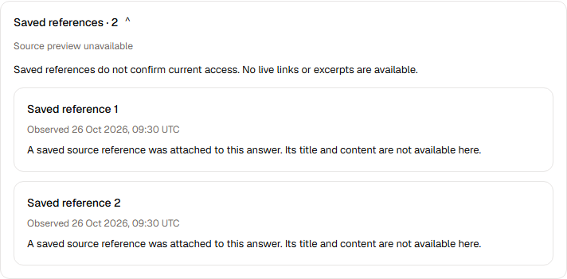
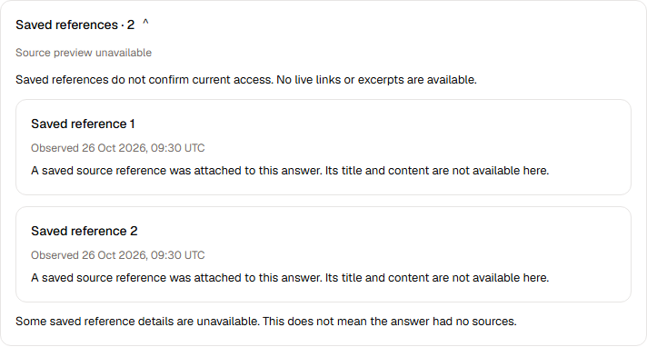
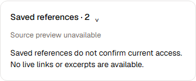
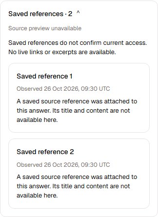

# Meri saved-reference disclosure — Figma 3.4

Author handoff, 26 October 2026. Ready for independent source and visual review; not merged, deployed or independently accepted.

## Scope and pinned design

Base `1b676415f640ba46d6e097dfa4dc2ef205e00933`, tree `cd505b5cee4f1e8f4de54a687198cfe4c73be63e`. Branch `codex/wave3-meri-saved-sources-figma34-20261026`.

[Canonical Figma board](https://www.figma.com/design/IXJzJUkXcUTkySHir5JNea/Capiro-3.4-Meri?node-id=3155-45681):
[collapsed](https://www.figma.com/design/IXJzJUkXcUTkySHir5JNea/Capiro-3.4-Meri?node-id=3155-45622),
[expanded](https://www.figma.com/design/IXJzJUkXcUTkySHir5JNea/Capiro-3.4-Meri?node-id=3155-45650),
[incomplete](https://www.figma.com/design/IXJzJUkXcUTkySHir5JNea/Capiro-3.4-Meri?node-id=3155-45679);
component set `3155:45680`. High-fidelity context and screenshots were read for all three states with the Figma design-to-code skill. m3_scope remains sole Figma writer.

The only product changes are `apps/web/src/features/meri/screens/sources/TurnSources.tsx` and saved-reference selectors in `apps/web/src/features/meri/cited-answer.module.css`. Dedicated existing unit/browser tests and this evidence are the remaining changes. ConversationTurn, shared Sources, SourceCard, other CSS selectors, contracts, recovery, operations, packages and lockfiles are unchanged. MF16 bill-text event production remains Integration's separate responsibility.

## Behavior and reuse

Saved references now start collapsed, retain a visible unavailable-preview/access limitation, and expand through the adopted Sources/Radix Collapsible. The existing feature SourceCard renders neutral numbered labels, actual saved observations formatted in UTC, and the approved unavailable-content explanation. No inferred titles, excerpts, claim mapping, URLs, current-access badges or new data fetches are introduced. Optional source-updated data is not presented; the typed evidence records remain unchanged.

Incomplete history keeps the distinction from zero sources, including when the disclosure is closed. Loading the remaining saved page removes the incomplete notice without losing either reference. Complete-empty and partial-empty wording remains distinct. The existing current-access denial removes expanded sources and answer content.

Reuse: public `@capiro/ui/sources`, the feature SourceCard, existing design tokens, and standard Intl.DateTimeFormat. No custom disclosure state machine or shared component was added. The root and reference cards retain 16px padding, 12px radius, 12px inter-card gaps, and 14/12/13px typography. The existing caption token is `#756e69`; Figma's fallback is `#78716c`. The canonical token is reused without changing global styles. Target variants contain no static image/SVG assets; their chevrons are the supplied text glyphs. No Figma screenshot or temporary asset URL is used in product code.

## Evidence and verification

Product Git blobs:
- TurnSources: `c7bf2618db02193e7068a20059b77676715ac067`
- cited-answer CSS: `113ff8faac0723972071299fc82545eca5b39b97`

Checks actually run, all final exits 0:
- `node ../../node_modules/vitest/vitest.mjs run tests/meri-citations.test.ts` from apps/web: **9/9 passed**, no skips. Exact admitted records, separate versions, complete/partial-empty truth, inert hostile text, clearing, and three retained tool-result truth cases.
- `node ../../node_modules/@playwright/test/cli.js test --config test/browser/playwright.config.ts meri-citations.spec.ts` from apps/web: **5/5 passed**, no skipped/flaky/unexpected results. Port 5323; explicit installed Chrome; synthetic fixtures; browser timezone America/New_York. Covers default closed, Enter/Space/Tab and visible focus, expanded/reload, separate references, incomplete history and loading the remaining page, mobile overflow, inert text/no source links, current-access denial, and differing actual UTC observations.
- Scoped TypeScript program using the app's parsed tsconfig, roots `apps/web/next-env.d.ts` and `apps/web/src/features/meri/screens/sources/TurnSources.tsx`, `noEmit:true`, `incremental:false`: **0 diagnostics** across that component and its imported dependency graph.
- ESLint on the changed TSX/unit/browser files; Prettier check on the four changed source/test files; `git diff --check`: passed.
- Four axe full-default scans report **0 violations**. Each desktop scan retains one incomplete color-contrast finding for the pre-existing sidebar Recent navigation button (partly obscured background); mobile has no incomplete findings. No source-card finding. Keyboard focus was visible, at least 2px, and within the viewport. This is not a claim of full application accessibility acceptance.

[Browser results](evidence/browser-results.json) and [computed geometry/typography](evidence/geometry.json) preserve exact final measurements. Geist was loaded for each capture. Desktop design-width CSS geometry is 712 × 113.9375 / 349.8125 / 380.65625px, within 1px of Figma's 114/350/381px heights. Raster edges can round outward at fractional scroll positions.

The existing conversation host admits 682px at the desktop fixture viewport; the card naturally uses that available width. For the nominal 712px screenshots only, the browser test temporarily widens its host and removes ancestor clipping, then restores every original inline style. Product component styles are unchanged by this capture helper. Interaction/accessibility checks run in the normal host. Mobile is 324px inside a 390px viewport, without horizontal overflow.








The initial screenshot assertions incorrectly assumed the host itself was 712px; the capture now distinguishes the actual 682px host from nominal design width. A test timestamp containing an offset was rejected by the existing public wire validator (`observedAt` requires a Z suffix); the final test supplies admitted UTC timestamps and uses a different browser timezone. No receiver or product behavior was weakened.

Runtime: Node 24.22.1, npm 11.19.1, TypeScript 5.9.3, Vitest 4.1.11, Playwright 1.61.1, ESLint 9.39.2, Prettier 3.8.1, axe 4.14.0, Chrome 155.0.8059.85. Existing local dependencies were linked read-only; no install or package/lock mutation. App-local contracts resolve the existing reviewed bc9a68f0 public distribution. Repository tarball SHA-256: `6e24472f649d9bc38b1a329b098b4f610500f5efdebc7724279962813352830a`. App-local UI/client links target this checkout's public packages.

## Cleanup, size and remaining gates

Removed the default-open prop, raw source/version diagnostic definition list, raw ISO date output, missing-update placeholder, old loaded-history sentence, and old sourceDetails dl/dt/dd CSS. Searches confirm none remains in this viewer. The previous standalone ChevronDownIcon import was removed; its shared library remains used elsewhere. No temporary product instrumentation, flags, lookup adapters, dependencies or unused assets were added. Unit test count remains nine; mounted coverage grows from three to five. No active caller of the removed viewer styles remains.

Bounded AST review: product component is 71 nonblank lines, TurnSources function 56; stylesheet 303. Unit test file 201 nonblank lines; its describe callbacks group the same six source cases (91 lines) and three unchanged tool cases (83 lines). These are cohesive test groupings, not new product responsibilities. Browser fixture/verification remains below 400 lines, with no function over 80 nonblank lines. No ownership or dependency-direction change or size-registry edit is needed.

The local browser server exited; no listener remains on port 5323. Shared dependency caches and prior worktrees are preserved. No cloud/database/provider access, install, pack, merge or deployment occurred. Full repository/typecheck/build/architecture campaigns and live acceptance were not run for this bounded presentation slice. Root schedules remaining integration gates, independent exact-head source/visual review, and Release shipping. Local synthetic results do not qualify live authorization or MF16 producer behavior.

## Standing requirements (full text, unchanged)

## 1. Claude handles the harness

The quality bar is Claude's own. Answer quality comes from the whole harness, not only the model: its system prompt, built-in tools, subagents, skills, context management and compaction, and session handling.

- Run `@anthropic-ai/claude-agent-sdk` with its **full harness** and the Claude Code system-prompt preset, plus a short Capiro/Meri append. Don't replace the preset with our own prose.
- Do not rebuild what the SDK or AWS already does: model calls, retries, streaming, the tool loop, context management and compaction, session resume/fork, per-run turn and spend limits, AWS credentials.
- The real Claude SDK calls Bedrock directly using its narrowly scoped AgentCore runtime IAM role. Preserve the full preset, native tools, subagents and all 14 skills.
- Capiro data reaches Claude as **tools** (rule 4), not as a custom retrieval layer around the model.

Spec and plan: `phases/wave2/WAVE2-00-CLAUDE-NATIVE-HARNESS-SPEC.md`. It is **Wave 2 item 0**, and it comes before every other item that touches the runner, the proxy or authority.

## 2. Simple, standard architecture

```text
browser -> control (current access, conversation/run ownership, durable events)
        -> AgentCore Runtime V1 (isolated conversation session; actual Claude SDK) -> Bedrock
                                      -> tool gateway -> Core
control -> existing durable SDK SessionStore and artifact owners
control -> Temporal for required durable runs, schedules and background work
```

- **Core is the gatekeeper for Capiro data.** Tenant, member, client and wall rules remain server-side in Core. Check current access at admission and actual tool/data/artifact access; revocation must also prevent use of previously loaded privileged context. Do not duplicate policy in the harness.
- Reuse one isolated environment only for the same immutable tenant/actor/conversation and approved General/client scope. Serialize turns; stop idle compute and restore exact SDK transcripts and artifacts from their durable owners. A Runtime session ID is not authorization or durable storage.
- Keep the SDK's per-run turn/spend limits and one canonical tenant cap/usage owner. Preserve required durable runs, schedules, consent, outcomes and uncertain-write fences; neither SDK Task tools nor a warm process replaces Temporal durability.
- **No custom warm pool, per-turn ECS task requirement, model proxy, duplicated per-hop authority, credential-minting service or spend-reservation ledger.** Use standard Runtime V1; no V2 snapshot machinery or second SDK implementation.
- Before adding a mechanism, identify the standard feature or existing owner it uses. Before deleting a wrapper, prove the retained lower-layer behavior with meaningful positive/negative tests. Do not remove canonical authorization, idempotency or durable outcomes as “extra security.”

## 3. Leave no dead code behind

A change is not done until what it replaced is gone.

1. **Delete in the same PR** everything the change makes unused: code, tests, fixtures, docs, config keys, env vars, feature flags, IAM statements, ALB rules, secrets, task definitions, CloudFormation resources, kit steps, alarms and metric filters. Applied database migrations are history: never edit them. Drop tables only through a separately reviewed forward migration after a snapshot; this hosting migration does not itself authorize schema/data removal.
2. **Temporary diagnostics come out before merge** of the fix they were added for. A log line stays only as named product telemetry that someone reads.
3. **No code behind a flag nothing turns on.** The "source-complete, activation-held" status is retired for code we don't intend to ship. Dark features need an owner and a date, or they are deleted.
4. **No** commented-out code, `legacy` or `_old` copies, compatibility shims for removed things, or "superseded" stubs.
5. **Show proof in the PR:** list the identifiers, files and resources deleted, with a search proving no executable/active caller remains; label immutable historical references, and explain any drop in test count.
6. **Old plan tickets for removed mechanisms are closed as superseded**, not implemented and left dormant. See `source-of-truth/SUPERSEDED-BY-ITEM-0.md`.
7. **Reuse before write.** Use SDK, AWS and library features first. Custom code needs one line saying what the standard option couldn't do.

## 4. Capiro data must keep working

- Capiro data is served to Claude as tools. Core remains the source: today's read families call Core at `/api/clio/tools/<operation>`, and the new tools call the same endpoints.
- Tools are hosted by **control** (the existing tool gateway) so the runner never holds the Core service secret (`x-internal-service-secret`). The runner gets only a short-lived per-run token for control, scoped to tenant, user, client, conversation and run.
- Reuse the existing read handlers under `apps/gateway/sources/*` and their typed schemas. Delete the authority, relay and measurement wrappers around them.
- Parity: every read family that works today must be reachable as a tool with the same results and the same permission outcomes. A parity checklist is part of the item 0 spec.
- Negative tests are mandatory: another tenant's data, another client's data, and walled data must not be retrievable, through chat or through tools. A General chat reads across the clients the user can already see, with each client's wall enforced per result (FINAL-PLAN decision 2).
- The original read-only first cut is historical. Neo subsequently authorized preview client-record writes and autonomous Wave 2 completion. Activate accepted writes through their existing authenticated domain/intent owners and receipts, with the actual route/configuration and effect semantics verified. This does not authorize the assistant to send external mail without the user's specific send instruction.
