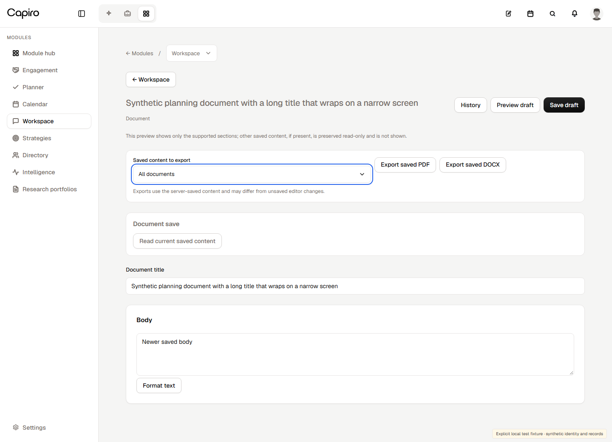
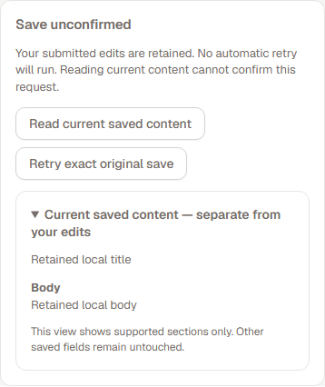
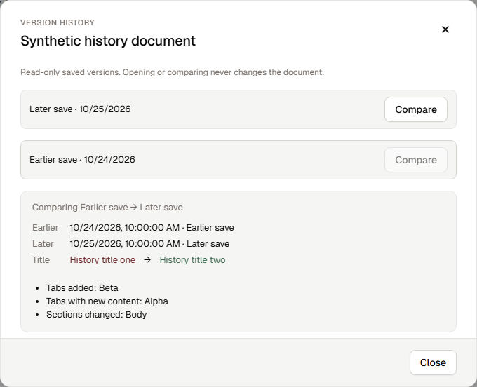
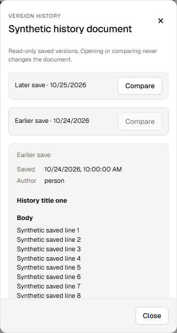
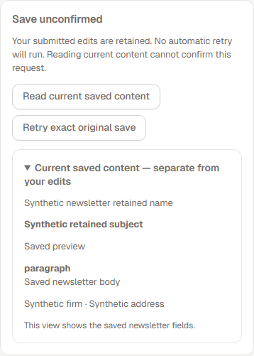
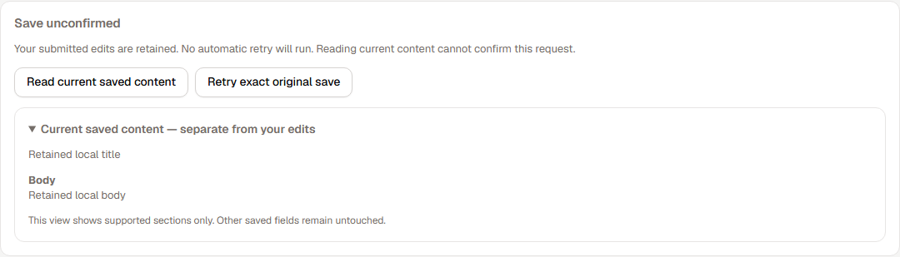
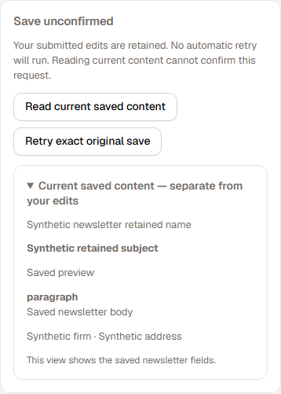

## 1. Claude handles the harness

The quality bar is Claude's own. Answer quality comes from the whole harness, not only the model: its system prompt, built-in tools, subagents, skills, context management and compaction, and session handling.

- Run `@anthropic-ai/claude-agent-sdk` with its **full harness** and the Claude Code system-prompt preset, plus a short Capiro/Meri append. Don't replace the preset with our own prose.
- Do not rebuild what the SDK or AWS already does: model calls, retries, streaming, the tool loop, context management and compaction, session resume/fork, per-run turn and spend limits, AWS credentials.
- The real Claude SDK calls Bedrock directly using its narrowly scoped AgentCore runtime IAM role. Preserve the full preset, native tools, subagents and all 14 skills.
- Capiro data reaches Claude as **tools** (rule 4), not as a custom retrieval layer around the model.

Spec and plan: `phases/wave2/WAVE2-00-CLAUDE-NATIVE-HARNESS-SPEC.md`. It is **Wave 2 item 0**, and it comes before every other item that touches the runner, the proxy or authority.

## 2. Simple, standard architecture

```text
browser -> control (current access, conversation/run ownership, durable events)
        -> AgentCore Runtime V1 (isolated conversation session; actual Claude SDK) -> Bedrock
                                      -> tool gateway -> Core
control -> existing durable SDK SessionStore and artifact owners
control -> Temporal for required durable runs, schedules and background work
```

- **Core is the gatekeeper for Capiro data.** Tenant, member, client and wall rules remain server-side in Core. Check current access at admission and actual tool/data/artifact access; revocation must also prevent use of previously loaded privileged context. Do not duplicate policy in the harness.
- Reuse one isolated environment only for the same immutable tenant/actor/conversation and approved General/client scope. Serialize turns; stop idle compute and restore exact SDK transcripts and artifacts from their durable owners. A Runtime session ID is not authorization or durable storage.
- Keep the SDK's per-run turn/spend limits and one canonical tenant cap/usage owner. Preserve required durable runs, schedules, consent, outcomes and uncertain-write fences; neither SDK Task tools nor a warm process replaces Temporal durability.
- **No custom warm pool, per-turn ECS task requirement, model proxy, duplicated per-hop authority, credential-minting service or spend-reservation ledger.** Use standard Runtime V1; no V2 snapshot machinery or second SDK implementation.
- Before adding a mechanism, identify the standard feature or existing owner it uses. Before deleting a wrapper, prove the retained lower-layer behavior with meaningful positive/negative tests. Do not remove canonical authorization, idempotency or durable outcomes as “extra security.”

## 3. Leave no dead code behind

A change is not done until what it replaced is gone.

1. **Delete in the same PR** everything the change makes unused: code, tests, fixtures, docs, config keys, env vars, feature flags, IAM statements, ALB rules, secrets, task definitions, CloudFormation resources, kit steps, alarms and metric filters. Applied database migrations are history: never edit them. Drop tables only through a separately reviewed forward migration after a snapshot; this hosting migration does not itself authorize schema/data removal.
2. **Temporary diagnostics come out before merge** of the fix they were added for. A log line stays only as named product telemetry that someone reads.
3. **No code behind a flag nothing turns on.** The "source-complete, activation-held" status is retired for code we don't intend to ship. Dark features need an owner and a date, or they are deleted.
4. **No** commented-out code, `legacy` or `_old` copies, compatibility shims for removed things, or "superseded" stubs.
5. **Show proof in the PR:** list the identifiers, files and resources deleted, with a search proving no executable/active caller remains; label immutable historical references, and explain any drop in test count.
6. **Old plan tickets for removed mechanisms are closed as superseded**, not implemented and left dormant. See `source-of-truth/SUPERSEDED-BY-ITEM-0.md`.
7. **Reuse before write.** Use SDK, AWS and library features first. Custom code needs one line saying what the standard option couldn't do.

## 4. Capiro data must keep working

- Capiro data is served to Claude as tools. Core remains the source: today's read families call Core at `/api/clio/tools/<operation>`, and the new tools call the same endpoints.
- Tools are hosted by **control** (the existing tool gateway) so the runner never holds the Core service secret (`x-internal-service-secret`). The runner gets only a short-lived per-run token for control, scoped to tenant, user, client, conversation and run.
- Reuse the existing read handlers under `apps/gateway/sources/*` and their typed schemas. Delete the authority, relay and measurement wrappers around them.
- Parity: every read family that works today must be reachable as a tool with the same results and the same permission outcomes. A parity checklist is part of the item 0 spec.
- Negative tests are mandatory: another tenant's data, another client's data, and walled data must not be retrievable, through chat or through tools. A General chat reads across the clients the user can already see, with each client's wall enforced per result (FINAL-PLAN decision 2).
- The original read-only first cut is historical. Neo subsequently authorized preview client-record writes and autonomous Wave 2 completion. Activate accepted writes through their existing authenticated domain/intent owners and receipts, with the actual route/configuration and effect semantics verified. This does not authorize the assistant to send external mail without the user's specific send instruction.

# Ordinary document presentation — source and visual handoff

Branch `codex/wave3-ordinary-presentation-figma34-20261026`, checkout `C:/dev/w3-ordinary-ui-20261026`, base `1b676415f640ba46d6e097dfa4dc2ef205e00933`, base tree `cd505b5cee4f1e8f4de54a687198cfe4c73be63e`.

## Result and ownership

The saved ordinary-document header now wraps title/actions cleanly and places export selection in its own labelled card. Recovery and explicit current readback are contained cards shared by ordinary documents and existing newsletters. History uses compact saved-version rows, a real document title, exact saved content and a contained chronological comparison; parent/client UUID diagnostics no longer appear by default.

The change owns only WorkspaceDraft presentation, OrdinaryDraftExport presentation, OrdinarySaveRecovery presentation, VersionHistory presentation, one scoped stylesheet and focused tests. Existing query/admission, controllers, export receiver, immutable save receipts, journal, editor state, newsletter state owner and shared controls remain canonical. Saved exports still read server-saved content; preview qualifications for supported/mixed/missing sections remain visible. Readback never confirms an unknown request, retry sends the captured original request, adoption/rebase remain separate explicit actions, and history stays read-only.

The heading remains “Document save” during pending operations and becomes “Save unconfirmed” for a settled unresolved request. The broad mounted run exposed the early-label timing issue: six tests advanced on “Save unconfirmed” while the original submission was still pending. One lost-response witness reproduced on the untouched base in `C:/dev/w3-ordinary-ui-base`, capturing an undefined request before dispatch. The presentation now uses the existing pending state to avoid prematurely naming the outcome. A dedicated held-submission test covers this. No controller or network timing was changed and no assertions were weakened.

Existing ActionButton, Field, SelectInput, Modal, SectionPreview and tokens are reused. The scoped stylesheet expresses the owned Figma geometry without expanding shared primitives or introducing a second state owner. Replaced Tabs/Panel UI and associated unit mocks are removed. The versionParentClient helper remains with its existing admission callers; only its diagnostic UI import was removed.

## Figma evidence

Read design-to-code context and screenshots from [the header/export target](https://www.figma.com/design/zGvvF6V6hh7yweoplCdpdE?node-id=3146-115934), [reconciliation target](https://www.figma.com/design/zGvvF6V6hh7yweoplCdpdE?node-id=3146-115961), [history dialog](https://www.figma.com/design/zGvvF6V6hh7yweoplCdpdE?node-id=1064-257658), and broader conflict context1176:297781. File session `8e51103b-fabd-4c6b-a892-cf4f6a3466e0`. Header/recovery/history Code Connect maps were empty. No static asset is required in these owned targets; unrelated shell assets were not copied.

History motion uses the supplied opacity0→1/y8→0 entrance over the first9% of a2second timeline, followed by a hold. It plays once under the repository's production-once MotionSurface policy rather than repeating the design preview indefinitely; reduced motion disables it. The mounted checks verify the one-iteration2s timeline and reduced-motion behavior. No shared motion owner changed.

Final captures use the installed Geist font, desktop1440px and narrow390px; history also exercises a720px viewport height. They show long-title/action wrapping, open export selection, qualifiers, unknown/readback states, newsletter readback, compact history rows, comparison and contained long-content scrolling. Keyboard tests cover native row selection, select Escape/focus, dialog Close/Escape/focus restoration and no writes from history. Synthetic fixture content is explicit.

## Validation

- Focused Vitest command from apps/web: `node ../../node_modules/vitest/vitest.mjs run tests/workspace-version-history.test.ts tests/workspace-ordinary-export.test.ts tests/workspace-ordinary-save.test.ts tests/workspace-ordinary-save-recovery.test.ts tests/workspace-newsletter-atomic-save.test.ts`: exit0, **98/98 passed**. After the final arrow accessibility attribute, the24 history tests passed again.
- Mounted command: `node ../../node_modules/@playwright/test/cli.js test --config test/browser/playwright.config.ts workspace-ordinary-presentation.spec.ts workspace-version-history.spec.ts workspace-ordinary-save.spec.ts workspace-ordinary-save-corrections.spec.ts workspace-newsletter-atomic-save.spec.ts`, with CAPIRO_BROWSER_TEST_DEV=1, port5323 and installed Chrome: exit0, **42/42 passed**, no skipped/flaky cases. The2 affected desktop/narrow history cases passed again after the final arrow accessibility correction. The earlier8 ordinary-export browser cases also passed; that export implementation has not changed since.
- **17 final screenshots**,8 default-rule axe scans of the owned export/recovery/dialog regions, **0 violations**. Export and recovery scans have0 incomplete checks. Each history scan has2 manual-review rule groups: contrast on the arrow glyph (and partially clipped scroll content on narrow), and label matching on the shared × close control. The arrow has an explicit image role/name; Close has the existing accessible name and native keyboard handling. Visible text/scroll containment were inspected in screenshots. No rules were disabled. This is scoped accessibility evidence, not a whole-app audit.
- Scoped TypeScript roots plus dependencies: **0 introduced diagnostics**;1 diagnostic on both changed source and base source overlay in workspace-newsletter-staging.ts: missing `projectionVersion` on the installed public contract. This is an inherited environment/contract failure, not a clean full-app typecheck. Full diagnostic evidence is retained.
- Touched TypeScript ESLint: exit0 from apps/web. Prettier and `git diff --check`: exit0. An accidental root-directory ESLint invocation found no config; it was rerun from the documented app directory successfully.
- Canonical AST scan run only for touched files; exact counts/fingerprints recorded for independent review. No whole architecture pass or registry approval is claimed.
- Runtime: Node24.22.1, npm11.19.1, TypeScript5.9.3, Vitest4.1.11, Playwright1.61.1, ESLint9.39.2, Prettier3.8.1, axe4.14.0, Chrome155.0.8059.85. Existing dependency links and the reviewed bc9a68f0 contracts distribution were reused without install/package changes. No listener remains on port5323.

Commands and results are summarized in `evidence/browser-results.json`, `evidence/typecheck.json`, `evidence/size-findings.json` and `evidence/verification.json`. Earlier failures are preserved as investigation outcomes; final checks do not omit failing cases.







## Scope cleanup and review signals

Removed the old history tab-selector rendering, Panel wrappers, default parent/client UUID definition-list rows, invented saved-title fallback, and their unit mock scaffolding. Their behavior tests now use accessible native row buttons and continue to enforce exact snapshot selection, chronological comparison, foreign-parent refusal, current-access denial, late responses, missing snapshots, unrecognised-content qualifications and escaped markup. Unit count for export/history remains48; browser history increases from6 to7, and the new presentation suite adds5 cases.

No save/export/history controller, receiver, journal, shared module-ui, workspace.module.css, package, lock or registry mutation is included. No source instrumentation or temporary feature flag remains. The stylesheet is dedicated to this owned presentation. The test-only font fulfilment reads the existing local Geist file because the development harness's dependency junction lies outside Vite's filesystem allowlist; it does not change the shared harness or permit external requests. Only captures using the verified font count as visual evidence.

Canonical scanner results are in `evidence/size-findings.json`. Product file sizes remain below400 nonblank lines. Changed function fingerprints require independent design/registry disposition for DraftEditor, OrdinaryDraftExport, OrdinarySaveRecovery, VersionHistory and SavedVersionComparison. WorkspaceDraft's existing98-line function fingerprint remains unchanged. The history browser fixture/test module and the pre-existing unit module exceed400 lines; the new presentation scenario callback is81 lines. These signals are reported, not self-waived; no size registry was edited. The functions retain their existing presentation responsibilities and state/dependency owners.

## Coordinated collaboration host splice

WorkspaceDraft remains exclusive through this freeze. After this ordinary source and PR189 are accepted, the author grants Integration the single a3-owned import and host composition. Integration can add the import `WorkspaceCollaboratorsPanel` from `./collaboration/WorkspaceCollaboratorsPanel` once that feature source exists, then place `{!draft.prospectId && <WorkspaceCollaboratorsPanel draftId={currentDraft.id} />}` inside DraftEditor's saved-draft actions immediately before VersionHistory. DraftEditor receives an existing saved draft; the ordinary path uses currentDraft from the accepted save owner. The feature resolves actor/people itself, so the host passes only draftId. No unresolved import or collaboration code was added here. Root coordinates the one-line host composition after independent review.

## Remaining gates and resources

No install, build, pack, full repository campaign, database/cloud/provider access, merge or deployment was performed. Source/visual independent review, size-registry disposition, integration composition and release/live qualification remain with Root, m3_scope and Release. These synthetic checks do not qualify live authorization or persisted backend behavior. The baseline checkout is retained as clean source evidence; prior worktrees and shared dependency caches remain intact. Test-created browser servers exit with their runs; final listener check is recorded in the external handoff.

## PR191 visual correction V1 — 26 October 2026 UTC

Library's independent visual review found that recovery action labels inherited muted body color instead of Figma3146:115961 foreground. The only product change is `.saveRecovery > .actions { color: var(--foreground); }` in the owned stylesheet. Explanatory copy remains muted; existing primary colors, disabled treatment, controller behavior and action gates are unchanged. The extra trailing blank line in BRIEF.md was trimmed without changing its standing rules or content.

Focused command from apps/web: `node ../../node_modules/@playwright/test/cli.js test --config test/browser/playwright.config.ts workspace-ordinary-presentation.spec.ts --grep 'ordinary presentation.*1440px|newsletter reuses.*390px'`, same development harness/port5323/Chrome. Exit0,2/2 passed. New assertions check foreground `rgb(10, 10, 10)` action labels and muted `rgb(117, 110, 105)` explanatory copy. Three affected scoped axe scans have0 violations and0 incomplete checks. Touched format/lint and diff checks pass; no full42/98 rerun or typecheck repetition. The inherited TS2339 projectionVersion finding is unchanged.

Corrected screenshots and result/source hashes are in `evidence/color-correction/`. These supersede the original recovery-label-color evidence; earlier screenshots retain their historical attribution. CSS SHA256: `fdcae4bc3908ea1d50b5ecc4de10b07cdb59d72a4261da6da7c6b18afd2c22ad`. CSS is309 nonblank lines, with no size finding. No product TypeScript function fingerprint changed. The test's ordinary presentation callback changes from81 to87 nonblank lines, fingerprint `71295e38925778fd4a0026da750157856ba69e451d3b695355a4714a4fafd495`; the test file is184 nonblank lines. No registry edit or self-waiver. Port5323 is clear.




**Root review request:** obtain Library's narrow visual delta review for V1 against the corrected ordinary desktop and shared newsletter narrow captures. Keep the previous source/behavior review and unchanged findings separate; Integration still owns the accepted191+189 host composition.

The separately allocated read-only WS16 section-library seam report is complete in the author's outputs/W3-WS16-RICH-SECTION-SOURCE-SEAM.md. No WS16 implementation or protected-file change was made.
